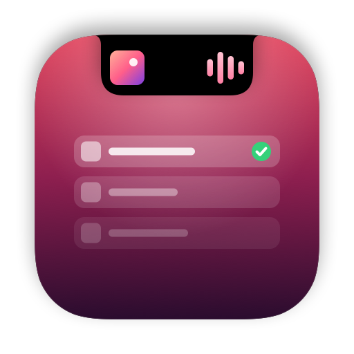
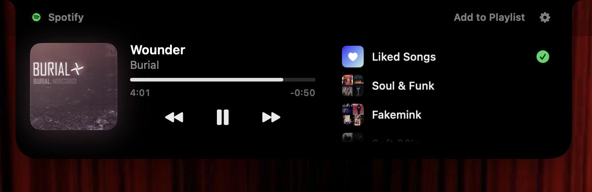

<p align="center">
  
</p>

<h1 align="center">MusicNotch</h1>

<p align="center">
  Hover your MacBook's notch to see what's playing, then add it to a playlist in one click.<br>
  Works with <b>Spotify</b> and <b>Apple Music</b>.
</p>

<p align="center">
  
</p>

<p align="center">
  
</p>

## What it does

- **Lives in the notch.** While music plays, the cover sits to the left of the notch and a
  small visualizer, tinted with the cover's color, sits to the right.
- **Opens on hover.** Point at the notch and it swells right away, then opens into a pill
  with the cover, title, a draggable progress bar and playback controls.
- **Play a playlist.** Hover a playlist and press ▶ next to the (+). Its songs slide in with
  the one playing highlighted. Click any song to play it and keep going through the playlist,
  and use the back arrow to return to your playlists.
- **Shuffle and volume.** Shuffle sits left of the controls and lights up in the player's color
  when on. The speaker on the right fills with the volume level: hover it to slide out a volume
  slider, or click it to mute.
- **One click to a playlist.** Your playlists are listed on the right. Click one to add the
  song; checkmarks show where it already is. Click a checked one to take it back out.
  *Liked Songs* (Spotify) and *Favorite Songs* (Apple Music) are always at the top.
- **Stays out of the way.** No Dock icon, never takes keyboard focus, and closes as soon as
  the pointer leaves. It uses almost no CPU while idle.

The motion follows Apple's fluid-interface principles. Springs can be interrupted mid-flight,
buttons respond on press rather than release, the pill grows out of the notch and returns into
it, and Reduce Motion is respected.

## Requirements

- macOS 15 or later. It looks best on a MacBook with a notch; on other displays it draws one.
- Swift 6.0 or later and the macOS 15 SDK to build: Xcode 16 or newer, or just its Command
  Line Tools (`xcode-select --install`). `scripts/build.sh` checks both and says what's missing.

## Install

```sh
git clone https://github.com/Ghalielouahdani/MusicNotch.git
cd MusicNotch
scripts/build.sh --install
```

`scripts/build.sh --run` builds into `build/` and launches from there instead.

The first time it runs, macOS asks whether MusicNotch may control Spotify or Music. Click
**OK**. If you declined, turn it back on in **System Settings › Privacy & Security › Automation**.

## Apple Music

No setup. Playlists, the "already in this playlist" checks, adding and removing all go through
Music's own scripting support. A song streamed from Apple Music is added to your library first
when Music requires that.

## Spotify

Now playing, playback controls, shuffle and volume work right away. Seeing your playlists and
adding songs to them takes one extra step, because Spotify only shares playlists with apps
registered on its developer site. It's free, takes about two minutes, and you only do it once:

1. Open the [Spotify Developer Dashboard](https://developer.spotify.com/dashboard), log in, and
   click **Create app**. Any name and description will do.
2. Under **Redirect URIs**, paste `http://127.0.0.1:47823/callback`. Tick **Web API**, then save.
3. Copy the app's **Client ID** into MusicNotch Settings (gear in the notch, or ♪ in the menu
   bar) and click **Connect Spotify**.

Spotify asks for Premium on the account that owns the developer app.

<details>
<summary>Privacy and details</summary>

- Login uses the Authorization Code flow with PKCE. There's no client secret, the browser
  redirect is caught by a listener bound to `127.0.0.1` only, and tokens stay in your Keychain.
- Playlists you start from the notch play through Spotify Connect, so the Spotify window stays
  where it is. If you connected before this was added, click **Reconnect** in Settings once.
- Spotify has no "is this song in that playlist" endpoint, so MusicNotch caches each playlist's
  track list in `~/Library/Caches/com.ghalielouahdani.MusicNotch/` and re-fetches a playlist
  only when it changes.

</details>

## How it works

| Folder | What's inside |
| --- | --- |
| `Sources/MusicNotch/Notch` | The floating panel, hover tracking, the notch shape and every notch view |
| `Sources/MusicNotch/Media` | Now-playing state from Spotify and Music: AppleScript plus their change notifications, no polling |
| `Sources/MusicNotch/Playlists` | A shared playlist interface and the Apple Music implementation |
| `Sources/MusicNotch/Spotify` | PKCE login, loopback listener, Keychain, Web API client, playlist index |
| `Sources/MusicNotch/App` | Entry point, settings window, snapshot renderer |

Useful flags while hacking on it:

```sh
build/MusicNotch.app/Contents/MacOS/MusicNotch --snapshot /tmp/shots   # render every notch state to PNG
build/MusicNotch.app/Contents/MacOS/MusicNotch --check-scripts         # compile every AppleScript, run none
build/MusicNotch.app/Contents/MacOS/MusicNotch --pin-open              # keep the notch open
/usr/bin/log stream --predicate 'subsystem == "com.ghalielouahdani.MusicNotch"' --level info
```

`scripts/make-icon.swift` draws the logo and app icon from code.

`scripts/build.sh` calls `swiftc` directly rather than `swift build`, because some Command Line
Tools installs ship a broken package-manifest library. `Package.swift` still works in Xcode.
The script signs with your Apple Development certificate if you have one, which keeps macOS
permissions across rebuilds; otherwise it signs ad hoc.

## Credits

Inspired by [boring.notch](https://github.com/TheBoredTeam/boring.notch). MusicNotch is a separate,
from-scratch app focused on getting songs into playlists.
